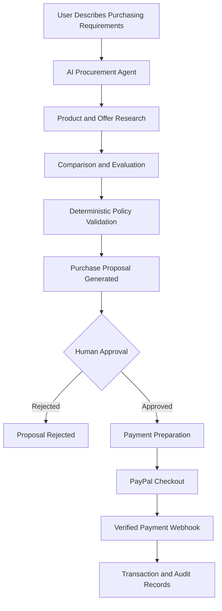

# ProcuraPay AI

### Autonomous Procurement. Human-Controlled Payments.

ProcuraPay AI is an AI-powered B2B procurement platform that transforms how organizations discover products, evaluate suppliers, manage purchasing decisions, and prepare payments.

Instead of manually searching across vendors, comparing offers, and navigating disconnected procurement workflows, users can describe their purchasing requirements in natural language. An intelligent AI agent analyzes the request, researches available options, compares products, evaluates organizational purchasing policies, and prepares a structured purchase proposal.

**The key principle: AI handles procurement intelligence. Humans retain payment authority.**

---

## Overview

Traditional procurement processes are often time-consuming, fragmented, and difficult to audit. Businesses must coordinate product research, vendor comparisons, budget checks, approvals, and payments across multiple systems.

ProcuraPay AI brings these activities into one intelligent workflow.

With ProcuraPay AI, organizations can:

- Describe purchasing requirements using natural language.
- Discover and compare relevant products and offers.
- Analyze purchasing options using AI-powered recommendations.
- Evaluate proposals against organizational purchasing policies.
- Generate structured procurement proposals.
- Review and approve purchases before payment.
- Process payments through PayPal integration.
- Track procurement activity and maintain an auditable history.

## How It Works



### 1. Natural Language Procurement

Users describe what their organization needs, including product specifications, quantities, budgets, and other purchasing requirements.

### 2. AI-Powered Research

The procurement agent analyzes the request and researches relevant products and available offers through configured data sources.

### 3. Intelligent Comparison

The system evaluates available options based on relevant factors such as:

- Price and budget compatibility.
- Product specifications.
- Quantity requirements.
- Vendor information.
- Organizational purchasing requirements.

### 4. Policy Validation

A deterministic policy engine evaluates the proposed purchase against organizational rules.

AI recommendations do not override company policies or approval requirements.

### 5. Human Approval

The platform generates a structured purchase proposal for human review.

An authorized user must explicitly approve the proposal before payment can proceed.

### 6. Payment Processing

Approved purchases proceed through the configured PayPal payment workflow.

Payment status is verified using appropriate payment-provider responses and webhook events.

### 7. Auditability

Procurement proposals, approvals, transactions, and relevant system activities are recorded to support accountability and traceability.

---

## Key Features

| Feature | Description |
|---|---|
| AI Procurement Agent | Converts natural language requirements into structured procurement requests. |
| Product Discovery | Researches relevant products and purchasing options. |
| Intelligent Comparison | Evaluates available offers against purchasing requirements. |
| Policy Engine | Enforces deterministic organizational procurement rules. |
| Human-in-the-Loop Approval | Requires explicit human authorization before payment. |
| PayPal Integration | Supports payment workflows through PayPal Developer APIs. |
| Organization Isolation | Separates organizational data using Supabase and PostgreSQL security controls. |
| Authentication | Supports secure account registration, email verification, and login. |
| Transaction Tracking | Maintains procurement and payment records. |
| Audit Logs | Records important procurement and approval activities. |
| Responsive Interface | Provides a modern interface for enterprise procurement workflows. |

---

## Technology Stack

### Frontend
- Next.js
- React
- TypeScript
- Tailwind CSS
- shadcn/ui
- Framer Motion
- Three.js
- React Three Fiber
- Drei

### Backend
- Node.js
- Express.js
- TypeScript

### Database and Authentication
- Supabase
- PostgreSQL
- Supabase Auth
- Row-Level Security (RLS)

### Artificial Intelligence
- Google Gemini API
- Structured AI responses
- Tool calling
- Agentic procurement workflows

### Payments
- PayPal Developer APIs
- PayPal Orders API v2
- PayPal JavaScript SDK
- PayPal Webhooks
- PayPal Sandbox

### Development and Testing
- pnpm
- Vitest
- Supertest
- Playwright
- Git and GitHub

---

## Architecture

ProcuraPay AI follows a modular architecture that separates the frontend, backend, AI orchestration, database, and payment processing responsibilities.

```text
ProcuraPay AI
│
├── Frontend
│   ├── Next.js
│   ├── React
│   ├── TypeScript
│   └── Tailwind CSS
│
├── Backend
│   ├── Node.js
│   ├── Express.js
│   ├── Authentication
│   ├── Procurement Services
│   ├── Policy Engine
│   └── Payment Services
│
├── AI Layer
│   ├── Gemini Integration
│   ├── Procurement Agent
│   ├── Product Research
│   ├── Offer Comparison
│   └── Proposal Generation
│
├── Data Layer
│   ├── Supabase
│   ├── PostgreSQL
│   ├── Row-Level Security
│   └── Audit Records
│
└── Payment Layer
    ├── PayPal Orders API
    ├── Checkout
    ├── Webhook Verification
    └── Transaction Tracking
```

---

## Security and Trust

ProcuraPay AI is designed around the principle that autonomous intelligence should not mean uncontrolled financial authority.

Important safeguards include:

- AI agents cannot independently authorize payments.
- Human approval is required before payment execution.
- Approval is associated with a specific proposal version and amount.
- Material proposal changes invalidate previous approval.
- Organizational data access is enforced through authorization and database-level security.
- Payment events must be verified before transaction records are treated as confirmed.
- Sensitive credentials are managed through environment variables.
- Important actions are recorded for auditability.

**AI recommends. Policies enforce. Humans authorize.**

---

## Getting Started

### Prerequisites

Make sure you have the following installed:

- Node.js
- pnpm
- Git
- A Supabase project
- A Google Gemini API key
- A PayPal Developer account

### 1. Clone the Repository

```bash
git clone https://github.com/YOUR_USERNAME/ProcuraPay-AI.git

cd ProcuraPay-AI
```

Replace the repository URL with the actual GitHub repository URL.

### 2. Install Dependencies

```bash
pnpm install
```

### 3. Configure Environment Variables

Create the required environment files based on the example environment files provided in the repository.

Typical configuration categories include:

**Frontend**
```env
NEXT_PUBLIC_SUPABASE_URL=
NEXT_PUBLIC_SUPABASE_ANON_KEY=
NEXT_PUBLIC_API_URL=
```

**Backend**
```env
PORT=5000
NODE_ENV=development

SUPABASE_URL=
SUPABASE_ANON_KEY=
SUPABASE_SERVICE_ROLE_KEY=

GEMINI_API_KEY=

PAYPAL_CLIENT_ID=
PAYPAL_CLIENT_SECRET=
PAYPAL_BASE_URL=
PAYPAL_WEBHOOK_ID=
```

Use the actual variable names defined in the project. Never commit real API keys, access tokens, service-role keys, or payment credentials.

### 4. Run the Development Environment

Use the scripts defined in the root `package.json`.

For example, if the repository provides a development script:

```bash
pnpm dev
```

Otherwise, start the frontend and backend using their respective workspace scripts.

### 5. Open the Application

Visit the local frontend URL printed by the development server, typically:

```text
http://localhost:3000
```

---

## Project Goals

ProcuraPay AI aims to demonstrate how agentic AI can improve enterprise procurement without compromising financial accountability.

The project focuses on:

1. Reducing manual procurement research.
2. Improving purchasing decisions through intelligent comparisons.
3. Enforcing organizational purchasing policies.
4. Introducing human-controlled payment authorization.
5. Improving transaction transparency and auditability.
6. Creating a scalable foundation for intelligent B2B commerce.

---

## Future Roadmap

Potential future improvements include:

- Advanced supplier discovery and verification.
- Multi-vendor procurement workflows.
- Automated purchase order generation.
- Advanced procurement analytics.
- Budget forecasting and spending insights.
- Multi-level approval workflows.
- ERP and accounting integrations.
- Additional payment-provider integrations.
- Supplier performance analytics.
- More advanced agentic procurement capabilities.

---

## Project Status

ProcuraPay AI is being developed as a hackathon project.

The implementation and availability of individual integrations depend on the current development and deployment state. External services may require their own API credentials, sandbox configuration, and account permissions.

---

## Built For

An exploration of **Agentic Commerce**: combining AI-powered procurement intelligence with transparent policies, human authorization, and secure payment workflows.

## Core Philosophy

> Autonomous Procurement. Human-Controlled Payments.

AI should make business purchasing smarter, faster, and more efficient — without taking financial control away from the people responsible for it.

---

## License

This project is currently developed as a hackathon project. Add an appropriate open-source license before permitting reuse or redistribution.

---

**ProcuraPay AI**  
*Making enterprise procurement intelligent, accountable, and human-controlled.*
